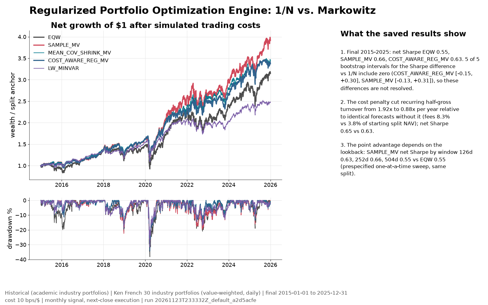

# Regularized Portfolio Optimization Engine: 1/N vs. Markowitz

**Live dashboard:** [https://regularized-portfolio-engine.streamlit.app](https://regularized-portfolio-engine.streamlit.app) (hosted on Streamlit Community Cloud; may take a moment to wake up)

How much do estimation error, portfolio constraints, and turnover change the practical performance
of mean-variance optimization relative to simply holding 1/N and rebalancing monthly?

This repository is a Python library, CLI (`rpo`), Streamlit dashboard, and reproducible comparison
suite. The engine estimates inputs, proposes constrained allocations, simulates monthly rebalancing
with next-close execution and an exact self-financing cost ledger, and explains the resulting
performance, allocations and estimation diagnostics. It is an engineering project with an empirical
analysis. It does not claim a new return signal or a replication of DeMiguel, Garlappi and Uppal (2009).



## Data and universe

* **Assets:** the 30 Kenneth French *value-weighted industry portfolios, daily, returns including
  distributions*. These are **academic research portfolios, not individual stocks or tradable
  ETFs**. Weights and dollar reallocations are hypothetical, and costs are stylized reallocation
  costs between research portfolios.
* **Risk-free:** daily `RF` from the Fama/French 3 Factors file.
* **Sample:** 1985-2025 (1985-1989 warmup), evaluated 1990-2025 on a continuous path with
  development (1990-2004), validation (2005-2014) and final (2015-2025) reporting splits.
* **Vintage:** the files were built from the 202609 CRSP database (current vintage, not
  point-in-time). Raw files are not committed. `rpo fetch` downloads them and every run records
  their SHA-256.

## Six methods, one feasible set

All methods are fully invested, long only, capped at 10% per industry, signalled at each month-end
close, and executed at the next close. All pay 10 bps per dollar traded in the ledger. **Only
COST_AWARE_REG_MV anticipates costs in its objective.**

`minimize (gamma/2) H w'Σw − H μ'w + κ ||w − w_signal||₁`, with γ = 5, H = 21 and κ = 0.001 (cost-aware method only).

| ID | Mean forecast | Covariance | Plans costs |
|---|---|---|---|
| EQW | (1/N at each signal) | | no |
| SAMPLE_MV | sample | sample | no |
| COV_SHRINK_MV | sample | Ledoit-Wolf (scaled identity) | no |
| MEAN_COV_SHRINK_MV | shrunk toward cross-sectional mean, ρ = 0.75 | Ledoit-Wolf | no |
| COST_AWARE_REG_MV | as above | Ledoit-Wolf | **yes** |
| LW_MINVAR | none (minimum variance) | Ledoit-Wolf | no |

## Key findings (run `20261123T233332Z_default_a2d5acfe`, final split 2015-01-01 to 2025-12-31)

The design was frozen in `design_freeze.json` before any backtest ran. The 2015-2025 data were
public beforehand, so the final period is not "unseen" in a prospective sense.

| Strategy | Net CAGR | Before-fee CAGR | Ann. vol | Sharpe | Max DD | Eff. N | Half-turnover/yr | Fees % anchor NAV |
|---|---|---|---|---|---|---|---|---|
| EQW | 11.0% | 11.0% | 18.4% | 0.55 | -38.2% | 30.0 | 0.20 | 0.8% |
| SAMPLE_MV | 13.2% | 13.7% | 18.2% | 0.66 | -33.7% | 10.2 | 2.01 | 9.0% |
| COV_SHRINK_MV | 13.3% | 13.8% | 18.2% | 0.67 | -33.7% | 10.2 | 2.00 | 9.0% |
| MEAN_COV_SHRINK_MV | 11.9% | 12.3% | 16.3% | 0.65 | -32.8% | 10.5 | 1.92 | 8.3% |
| COST_AWARE_REG_MV | 11.7% | 11.9% | 16.4% | 0.63 | -34.3% | 10.8 | 0.88 | 3.8% |
| LW_MINVAR | 8.6% | 8.7% | 14.5% | 0.50 | -31.6% | 11.0 | 0.71 | 2.6% |

1. **1/N is not decisively beaten.** The optimized portfolios have higher point Sharpe ratios, but
   all five paired moving-block bootstrap intervals for the Sharpe difference vs EQW include zero
   (e.g. SAMPLE_MV +0.11, 95% interval [-0.13, +0.31]; 20-day blocks, 1,000 replications). The
   exploratory 10- and 40-day block lengths (full preset) give the same picture.
2. **The advantage is fragile to the lookback.** With a 504-day window, SAMPLE_MV's final-split
   Sharpe falls to 0.55, the same as EQW (0.63 at 126 days, 0.66 at 252 days). Every prespecified
   cell is reported in [`docs/results/sensitivity_results.csv`](docs/results/sensitivity_results.csv).
3. **Covariance shrinkage conditions the matrix; mean shrinkage moves the weights.** Ledoit-Wolf
   intensity averaged α = 0.033 and cut the median condition number by 37% (335 to 213), yet
   targets moved by a mean L1 distance of only 0.009. Mean shrinkage moved them by 0.405.
4. **Planning for costs cuts turnover by more than half and keeps most of the return.** With identical forecasts,
   the L1 penalty cut recurring half-gross turnover from 1.92x to 0.88x per year and fees from 8.3%
   to 3.8% of starting NAV; net Sharpe went from 0.65 to 0.63.
5. **Synthetic Monte Carlo (labeled as such).** With known Gaussian moments (N = 30, cap 3/N), 1/N
   has the lowest mean oracle regret even when true means differ (case 3) at every estimation
   length from 126 to 504 days. Shrinkage minimum variance comes closest to the oracle when means
   are equal but risks differ (case 2), where it beats 1/N.

These are conditional, historical results for one design; see the
[technical note (PDF)](docs/results/technical_note.pdf) and [methodology](docs/methodology.md).

## Quickstart

The project uses [uv](https://docs.astral.sh/uv/) and Python 3.12 from a locked environment (`uv.lock`).

**macOS / Linux**

```bash
curl -LsSf https://astral.sh/uv/install.sh | sh
```

```bash
uv sync --locked
```

```bash
uv run rpo demo
```

**Windows (PowerShell)**

```powershell
powershell -ExecutionPolicy ByPass -c "irm https://astral.sh/uv/install.ps1 | iex"
uv sync --locked
uv run rpo demo
```

Real data and the full comparison (all commands run from the repository root):

```bash
uv run rpo fetch --config configs/default.yaml
```

```bash
uv run rpo validate --config configs/default.yaml
```

```bash
uv run rpo reproduce --config configs/default.yaml --preset core
```

```bash
uv run rpo dashboard --run latest
```

| Command | What it does |
|---|---|
| `rpo demo` | Offline SYNTHETIC demonstration (about 6 s on an M4), labeled synthetic everywhere |
| `rpo fetch --config configs/default.yaml` | Download and cache the official files, keeping the original bytes and recording SHA-256 |
| `rpo validate --config configs/default.yaml` | Data and config validation report |
| `rpo reproduce --config configs/default.yaml --preset core` | Design freeze, primary run, sweeps, bootstrap, stress view, frontier snapshot, core Monte Carlo, reports |
| `rpo reproduce --config configs/full.yaml --preset full` | Adds the full Monte Carlo (N ∈ {10, 30, 60}, 200 replications, checkpointed) and exploratory bootstrap block lengths |
| `rpo report --run <run_id>` | Regenerate figures, `report.html`, `technical_note.pdf`, and presentation assets from saved tables |
| `rpo dashboard --run <run_id>` | Launch the Streamlit dashboard on a saved run (read-only, no re-optimization) |
| `rpo optimize returns.csv --as-of 2024-06-28 --units decimal [--weights-csv w.csv]` | Target for a user return panel |
| `rpo list-runs` | List saved runs and statuses |

If the download fails, save the two ZIP files from the
[Data Library](https://mba.tuck.dartmouth.edu/pages/faculty/ken.french/data_library.html) into
`data/raw/` under their original names. `rpo validate` parses them with the same code and records
"manual placement" provenance.

### Live demo (Streamlit Community Cloud)

Deployed at [https://regularized-portfolio-engine.streamlit.app](https://regularized-portfolio-engine.streamlit.app) from `main` (`app/dashboard.py`, Python 3.12).

The dashboard can run as a free hosted app. `demo_runs/` holds a trimmed copy of the headline
run (derived results only, about 21 MB, built by `scripts/bundle_demo_run.py`), which the
dashboard loads when no local `outputs/` run exists. `requirements.txt` is exported from
`uv.lock` and CI checks that the two match.

1. Sign in at [share.streamlit.io](https://share.streamlit.io) with GitHub.
2. Create app → repository `cfultz7/regularized-portfolio-engine`, branch `main`, main file
   `app/dashboard.py`.
3. Advanced settings → Python 3.12. Deploy.

Verified locally by simulating that setup (fresh copy, `pip install -r requirements.txt`,
`streamlit run app/dashboard.py`): the app loads the bundled run with no errors and peaks at
about 480 MB of memory. Free apps sleep after inactivity and take a little while to wake.

### Python API

```python
import pandas as pd
from portfolio_engine.optimizer import optimize_user_panel

returns = pd.read_csv(
    "returns.csv", index_col="date", parse_dates=True
)  # decimal daily simple returns
current = pd.Series({"A": 0.5, "B": 0.5})  # risky weights at the as-of close
target, info = optimize_user_panel(
    returns,
    as_of="2024-06-28",
    current_weights=current,
    method="COST_AWARE_REG_MV",
    max_weight=0.10,
    cost_bps=10,
)
```

## Platform compatibility

| Platform | Status | Evidence |
|---|---|---|
| macOS 15.7.7, Apple M4 (arm64), Python 3.12.16, uv 0.13.9 (local) | **Tested, offline and empirical** | `uv sync --locked` from a clean copy; Ruff, `ruff format --check`, mypy; 72 pytest cases; `rpo fetch/validate/demo/reproduce (core and full)/report/optimize/list-runs` on the real Ken French data; dashboard startup smoke test and visual check |
| Windows (GitHub Actions `windows-latest`, image `windows-2025-vs2026`) | **Tested, offline (CI)** | CI run [44875999435](https://github.com/cfultz7/regularized-portfolio-engine/actions/runs/44875999435): `uv sync --locked` (CPython 3.12.16), Ruff, format check, mypy, 72 pytest cases, `rpo demo`, `rpo report`, dashboard startup smoke |
| Linux (GitHub Actions `ubuntu-latest`, image `ubuntu-26.04`) | **Tested, offline (CI)** | Same CI run and steps |
| macOS (GitHub Actions `macos-latest`, image `macos-26-arm64`) | **Tested, offline (CI)** | Same CI run and steps |

CI runs everything offline on synthetic data. The real-data download (`rpo fetch`) and the
empirical reproductions have been run only on the local Mac; on Windows and Linux they are
**expected** to work (same code paths, standard-library HTTPS download) but are not yet verified.

Portability measures: `pathlib` paths, UTF-8 file I/O, atomic writes with `os.replace`, ASCII CLI
output, colon-free run IDs, no shell calls in the engine, a universal `uv.lock`, pure-wheel
dependencies (no compilers), and a standard-library dashboard smoke script.

## Verification status

* `uv run pytest -q`: 72 passed. Tests cover section selection, sentinels and one-time unit
  conversion, invalid CSVs, hand-calculated drift, the three-date execution-lag example,
  future-data perturbation, self-financing identities, NAV scaling, an inverse-variance analytic
  case, a two-asset grid and analytic check, cap feasibility, ρ = 1 reduction to minimum variance,
  zero-cost equivalence, column permutation, PSD handling, solver failure handling, metric
  formulas with split anchors, seeded reproducibility, the immutable design freeze, report/table
  agreement, and dashboard rendering.
* Measured wall time on this machine (Apple M4, 10 cores, 16 GB): core
  reproduce 26.4 s; full reproduce 58.8 s (manifest `timings`).
* The primary run had 2,165 optimizer solves, all `optimal` with Clarabel, and 0 solver failures.
  The final 2025-12-31 signal of each method is recorded as a pending proposal.

## Repository layout

```
configs/            default.yaml (frozen design), full.yaml, smoke.yaml (synthetic)
src/portfolio_engine/
  config.py data.py estimates.py constraints.py optimizer.py strategies.py accounting.py
  backtest.py metrics.py diagnostics.py experiments.py simulation.py artifacts.py reporting.py cli.py
app/                dashboard.py, components.py (Streamlit + Plotly; saved runs only)
tests/              pytest suite; fixtures/ are SYNTHETIC
docs/               methodology, data dictionary, decisions, assets (figures), results (tables, report, note)
scripts/            smoke_dashboard.py (cross-platform startup check)
outputs/<run_id>/   manifest.json, design_freeze.json, tables/, figures/, report.html, technical_note.pdf, presentation/
```

## Documentation

[Methodology](docs/methodology.md) ·
[Data dictionary](docs/data_dictionary.md) ·
[Decisions](docs/decisions.md) ·
[Technical note](docs/results/technical_note.pdf) ·
[HTML report](docs/results/report.html)

## Verified vs planned

**Verified (macOS locally; offline pipeline also in CI on Windows, Linux, macOS):** all six methods; data adapters; ledger and timing; design
freeze; core and full experiment presets; bootstrap; stress view; frontier snapshot; dashboard;
HTML/PDF reports; shareable images.

**Also verified:** the hosted dashboard at https://regularized-portfolio-engine.streamlit.app renders all five tabs from the bundled run.

**Planned / not done:** an empirical (real-data) run on Windows and Linux; the optional
covariance-shift simulation; a tradable-ETF universe; a hard turnover constraint.

## Limitations

These are current-vintage academic industry portfolios, not tradable instruments. Costs are
linear and stylized. Next-close execution is a simulation convention. The evaluation covers one
prespecified design with one-at-a-time sweeps. Sharpe ratios use square-root-of-time
annualization. Bootstrap intervals are conditional on observed returns and not adjusted for
multiple comparisons. There are no taxes, capacity limits or market impact.

## References

Markowitz (1952), *Portfolio Selection*; DeMiguel, Garlappi and Uppal (2009), *Review of Financial
Studies*; Ledoit and Wolf (2004), *A Well-Conditioned Estimator for Large-Dimensional Covariance
Matrices* (the scaled-identity estimator used here, via
[scikit-learn LedoitWolf](https://scikit-learn.org/stable/modules/generated/sklearn.covariance.LedoitWolf.html));
CVX Group [portfolio optimization](https://www.cvxgrp.org/cvx_short_course/docs/applications/notebooks/portfolio_optimization.html)
and [rebalancing](https://www.cvxgrp.org/cvx_short_course/docs/exercises/notebooks/13.21.html) notebooks.

## Data attribution and license

Return data come from the [Kenneth R. French Data Library](https://mba.tuck.dartmouth.edu/pages/faculty/ken.french/data_library.html)
(Eugene F. Fama and Kenneth R. French). This repository does not redistribute the raw files and
claims no rights in them. The project code is under the [MIT License](LICENSE).
